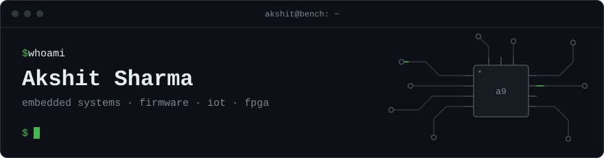

<p align="center">
  
</p>

I build things that sit between hardware and software: microcontroller firmware, sensor networks, FPGA designs, and the tools and ML models around them. Currently doing an M.E. in Embedded Systems at BITS Pilani, Goa. Voiding warranties for fun.

### `~/now`

```text
building   WayPoint: an ESP32 handheld that finds where you are indoors from WiFi
studying   M.E. Embedded Systems @ BITS Pilani, Goa
based in   Palampur, Himachal Pradesh
```

### `~/projects`

| project | what it is | stack |
|:--|:--|:--|
| [**WayPoint**](https://github.com/akshit-a9/WayPoint) | Handheld indoor navigation device. Scans 2.4 GHz WiFi, asks a localization API where it is, and shows the answer on an OLED. Logs IMU data for dead reckoning between fixes. | `ESP32` `C++` `MPU6050` |
| [**Indoor-Localization**](https://github.com/akshit-a9/Indoor-Localization) | WiFi RSSI fingerprinting across two floors of an academic building: Android data collection, classical ML models, a FastAPI service, and on-device ONNX inference in Flutter and Kotlin apps. | `Python` `scikit-learn` `ONNX` `Flutter` |
| [**Crowdy**](https://github.com/akshit-a9/Privacy_Preserving_Occupancy_Analysis_WSN) | Camera-free crowd sensing for campus spaces. mmWave radar, vibration and acoustic sensors feed an STM32 that sends out only a congestion index over a multi-hop TelosB mesh. | `STM32` `C` `TinyOS` |
| [**F1 Pit Wall**](https://github.com/akshit-a9/F1_Telemetry_Tracker) | Live pit wall for F1 2020 online lobbies. Every driver's UDP telemetry goes to one host; the dashboard shows gaps, tyres, setups, incidents and per-driver engineering advice. | `Python` `UDP` `Web` |
| [**Pipeline Simulator**](https://github.com/akshit-a9/Pipeline_Simulator) | Visual simulator for a 6-stage pipelined processor with forwarding and branch prediction, driven by assembly files. | `Python` `TypeScript` |

<details>
<summary><b>Team projects</b></summary>
<br>

| project | what it is | stack |
|:--|:--|:--|
| [**Synth**](https://github.com/akshit-a9/synth) | FPGA music synthesizer: joystick-controlled pitch and volume, with sine, square, triangle and sawtooth waveforms. | `FPGA` `Verilog` |
| [**Miniscope**](https://github.com/akshit-a9/miniscope) | Small oscilloscope built on an STM32. | `STM32` `C` |
| [**Plot Protector**](https://github.com/akshit-a9/plot-protector) | Spoiler detection in movie and TV show reviews. | `Python` `ML` |
| [**Behavioral Biometrics**](https://github.com/akshit-a9/Authentication_Using_Behavioral_Biometrics) | Passwordless second factor that recognises a phone's owner from how they hold, move and use it. | `Android` `ML` |

</details>

<details>
<summary><b>Coursework, M.E. Embedded Systems</b></summary>
<br>

| course | repo |
|:--|:--|
| Processor Architecture and Design | [MES2_Processor_Architecture_Design](https://github.com/akshit-a9/MES2_Processor_Architecture_Design) |
| Distributed and Networked Embedded Systems | [MES2_Distributed_Networked_Embedded_Systems](https://github.com/akshit-a9/MES2_Distributed_Networked_Embedded_Systems) |
| Software for Embedded Systems | [MES2_Software_For_Embedded_Systems](https://github.com/akshit-a9/MES2_Software_For_Embedded_Systems) |
| Real Time Embedded Systems | [MES1_Real_Time_Systems](https://github.com/akshit-a9/MES1_Real_Time_Systems) |
| Reconfigurable Computing | [MES1_Recon_Computing](https://github.com/akshit-a9/MES1_Recon_Computing) |
| Embedded System Design | [MES1_Embedded_System_Design](https://github.com/akshit-a9/MES1_Embedded_System_Design) |
| Machine Learning for Electronics Engineers | [MES1_Machine_Learning](https://github.com/akshit-a9/MES1_Machine_Learning) |
| Undergrad, assorted | [Undergrad](https://github.com/akshit-a9/Undergrad) |

</details>

### `~/stack`

```text
languages   C · C++ · Python · Verilog · VHDL · TypeScript · Dart
hardware    ESP32 · STM32 · TelosB · FPGA · I2C · SPI · UART
software    TinyOS · FastAPI · Flutter · scikit-learn · ONNX
tools       Keil · STM32CubeMX · Vivado · Arduino · Git · Linux
```

### `~/contact`

[LinkedIn](https://www.linkedin.com/in/actuallyakshit/) · [X](https://x.com/actuallyakshit) · [akshitsharma2002@gmail.com](mailto:akshitsharma2002@gmail.com) · Discord `molloo`
